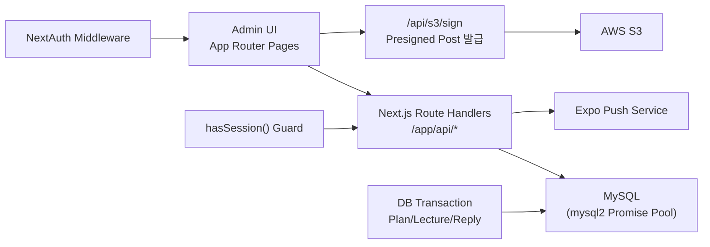

# Our Pray Admin Dashboard

> 기도 콘텐츠 운영, 사용자 상태 관리, 질문/답변 응대를 하나의 백오피스로 통합한 관리자 대시보드입니다.


## 목차
1. [TL;DR](#tldr)
2. [문제 정의와 목표](#문제-정의와-목표)
3. [핵심 기능](#핵심-기능)
4. [시스템 아키텍처](#시스템-아키텍처)
5. [기술적 의사결정 (Deep Dive)](#기술적-의사결정-deep-dive)
6. [정량 지표 (엔지니어링 규모)](#정량-지표-엔지니어링-규모)
7. [실행 방법](#실행-방법)
8. [트러블슈팅 / 회고](#트러블슈팅--회고)
9. [Contact](#contact)

## TL;DR
- **문제**: 앱 운영자가 사용자 상태, 기도 플랜/강의, 질문 답변, 알림 발송을 각각 분리된 프로세스로 처리해야 했습니다.
- **해결**: Next.js App Router 기반 관리자 대시보드에서 핵심 운영 플로우를 단일 UI + API 계층으로 통합했습니다.
- **핵심 구현**: S3 Presigned 업로드, 트랜잭션 기반 다중 테이블 반영, 질문 답변 후 Expo 푸시 알림, 관리자 권한/상태 변경.
- **성과(엔지니어링 규모)**: API Route 13개, HTTP 핸들러 24개, 트랜잭션 6개, 검증 refine 규칙 12개를 운영 업무 중심으로 구성했습니다.
- **기여 형태**: 개인 단독 개발(설계, 구현, 유지보수).

## 문제 정의와 목표
| 항목 | 내용 |
|---|---|
| 운영 문제 | 사용자 관리/기도 콘텐츠 관리/상담 응대/알림 발송이 분리되어 운영 효율이 낮음 |
| 기술 목표 | 운영자가 하나의 관리자 UI에서 CRUD + 발송 + 상태 변경을 일관되게 수행 |
| 품질 목표 | 입력 검증, 트랜잭션, 인증 가드로 운영 중 데이터 일관성과 보안 확보 |
| 결과 목표 | 신규 콘텐츠 등록부터 사용자 커뮤니케이션(답변/알림)까지 리드타임 단축 |

## 핵심 기능
| 기능 | 관리자 업무 플로우 | 코드 근거 |
|---|---|---|
| 사용자 상태/권한 관리 | role/status 변경 모달에서 즉시 반영 | `app/(dashboard)/users/user-status-modal.tsx`, `app/api/user/[...path]/route.ts` |
| 기도 플랜 생성/수정 | 이미지 3종 업로드 + 메타데이터 저장 | `app/(dashboard)/plan/create/plan-detail.tsx`, `app/api/plan/route.ts` |
| 강의/오디오 관리 | 신규/기존/삭제 분기를 포함한 강의 편집 | `app/(dashboard)/lecture/[plan_id]/update/[lecture_id]/lecture-detail.tsx`, `app/api/lecture/route.ts` |
| 질문 답변 + 푸시 알림 | 질문 상세에서 답변 작성, 저장 후 사용자 푸시 발송 | `app/(dashboard)/question/[id]/page.tsx`, `app/api/question_reply/route.ts` |
| 알림 문구 관리 + 전체 발송 | 알림 문구 CRUD 후 대상 사용자 일괄 전송 | `app/(dashboard)/alarm/alarmSendModal.tsx`, `app/api/alarm/send/route.ts` |

### 시각 자료
> 현재 저장소에는 비식별 처리용 placeholder 파일이 포함되어 있습니다. 실제 제출 시 동일 파일명으로 캡처/GIF를 교체하면 됩니다.


## 시스템 아키텍처


## 기술적 의사결정 (Deep Dive)
### 1) 대용량 미디어 업로드: 서버 경유 업로드 대신 S3 Presigned Post
- 문제: 강의 오디오(최대 300MB)와 이미지 업로드를 서버가 직접 중계하면 API 부하와 실패 확률이 증가.
- 결정: `/api/s3/sign`에서 업로드 권한만 발급하고, 클라이언트에서 S3로 직접 업로드.
- 구현 포인트:
  - MIME 타입별 용량 제한(`image: 10MB`, `audio: 100MB`)을 서버에서 제어.
  - 파일 확장자 추론 로직을 분리해 DB 저장 스키마와 일관성 유지.
- 근거: `app/api/s3/sign/route.ts`, `lib/s3.ts`

### 2) 다중 엔티티 갱신의 일관성: 트랜잭션 우선 설계
- 문제: 플랜/강의/답변 처리 시 여러 테이블이 함께 갱신되므로 부분 실패 시 데이터 불일치 발생 가능.
- 결정: `beginTransaction -> commit/rollback` 패턴을 주요 쓰기 API에 적용.
- 구현 포인트:
  - 플랜 생성 시 `plan` + `plan_lecture_audit` 동시 반영.
  - 강의 생성/수정 시 `lecture` + `lecture_audio` + `audit` 동시 반영.
  - 답변 등록 시 `question_reply` + `question.is_answered` + 푸시 발송 흐름 관리.
- 근거: `app/api/plan/route.ts`, `app/api/lecture/route.ts`, `app/api/question_reply/route.ts`

### 3) 운영 입력 안정성: 스키마 검증 + 콘텐츠 필터링
- 문제: 관리자 입력 실수와 자유 텍스트 입력(XSS 가능성)으로 운영 데이터 품질/보안 리스크 존재.
- 결정: 클라이언트 폼은 `zod + zod-form-data`로 검증하고, 서버에서는 민감 텍스트를 필터링.
- 구현 포인트:
  - 파일 타입/크기, 문자열 길이, 반복 필드(오디오/자막 목록) 검증.
  - 답변/알림 텍스트에 `XSSFilter` 적용.
- 근거: `lib/form.ts`, `app/api/alarm/route.ts`, `app/api/question_reply/route.ts`

## 정량 지표 (엔지니어링 규모)
| 지표 | 값 | 재현 커맨드 |
|---|---:|---|
| API Route 파일 수 | 13 | `find app/api -name 'route.ts' | wc -l` |
| HTTP 핸들러 수 | 24 | `rg "^export async function (GET|POST|PATCH|PUT|DELETE)" app/api -n | wc -l` |
| 대시보드 페이지 수 | 12 | `find 'app/(dashboard)' -name 'page.tsx' | wc -l` |
| 서버 액션 파일 수 | 9 | `find lib/serverActions -name '*.ts' | wc -l` |
| 환경변수 키 사용 수 | 11 | `rg "process\\.env\\.([A-Z0-9_]+)" -or '$1' app lib \| sort -u \| wc -l` |
| 트랜잭션 사용 횟수 | 6 | `rg "beginTransaction\\(" -n app lib | wc -l` |
| 검증 refine 규칙 수 | 12 | `rg "\\.refine\\(" lib/form.ts | wc -l` |
| 사이드바 핵심 메뉴 수 | 6 | `rg "<NavItem href=" 'app/(dashboard)/layout.tsx' | wc -l` |

## 실행 방법
### 1) 사전 준비
- Node.js 20+
- pnpm
- MySQL
- AWS S3 버킷
- GitHub OAuth 앱(NextAuth용)

### 2) 환경변수
`.env`에 아래 키를 설정합니다. (값은 문서에 노출하지 않음)

| 키 | 설명 |
|---|---|
| `DB_HOST` | MySQL 호스트 |
| `DB_USER` | MySQL 사용자 |
| `DB_PASSWORD` | MySQL 비밀번호 |
| `DB_DATABASE` | DB 이름 |
| `AWS_BUCKET_NAME` | 업로드 대상 S3 버킷 |
| `AWS_REGION` | S3 리전 |
| `AWS_ACCESS_KEY_ID` | AWS 접근 키 |
| `AWS_SECRET_ACCESS_KEY` | AWS 비밀 키 |
| `EXPO_ACCESS_TOKEN` | Expo Push 토큰 |
| `AUTH_GITHUB_ID` 또는 `GITHUB_ID` | GitHub OAuth Client ID |
| `AUTH_GITHUB_SECRET` 또는 `GITHUB_SECRET` | GitHub OAuth Client Secret |

### 3) 로컬 실행
```bash
pnpm install
pnpm dev
```

### 4) 빌드/실행
```bash
pnpm build
pnpm start
```

### 5) 참고
- `lib/serverActions/auth.ts`에서 `NODE_ENV=development`일 때 세션 검증이 완화되어 있습니다.
- 운영 반영 전에는 인증 정책을 반드시 점검하세요.

## 트러블슈팅 / 회고
### 1) 강의 BGM 확장자 저장 불일치
- 현상: 강의 수정 시 확장자 필드명이 섞여 재생/저장 동작이 흔들리는 케이스 발생.
- 대응: 확장자 필드 참조를 일관화하고 저장 시점 로직 정리.
- 반영: `f192041`, `7711d49` 관련 수정 흐름.

### 2) 강의 오디오 표시 순서 불안정
- 현상: 오디오 세그먼트가 의도한 시작 시간 순서대로 보이지 않음.
- 대응: 조회 쿼리에 `ORDER BY start_time ASC`를 강제.
- 근거: `lib/serverActions/lecture.ts`, `7c69010`.

### 3) 답변 이후 사용자 커뮤니케이션 지연
- 현상: 답변 저장 후 사용자 인지가 늦어지는 문제.
- 대응: 답변 저장 트랜잭션 안에서 `is_answered` 반영 + Expo 푸시 발송 연계.
- 근거: `app/api/question_reply/route.ts`, `lib/notification.ts`, `562a2ae`.

## Contact
- GitHub: [https://github.com/ehdrbdndns](https://github.com/ehdrbdndns)
- Blog: [블로그 링크 업데이트 예정](https://example.com)
- Email: [ehdrbdndns@naver.com](mailto:ehdrbdndns@naver.com)
- Resume: [이력서 링크 업데이트 예정](https://example.com)
